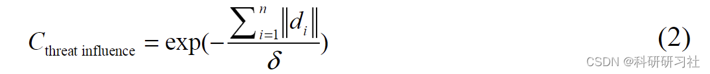
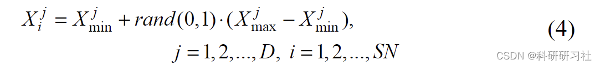
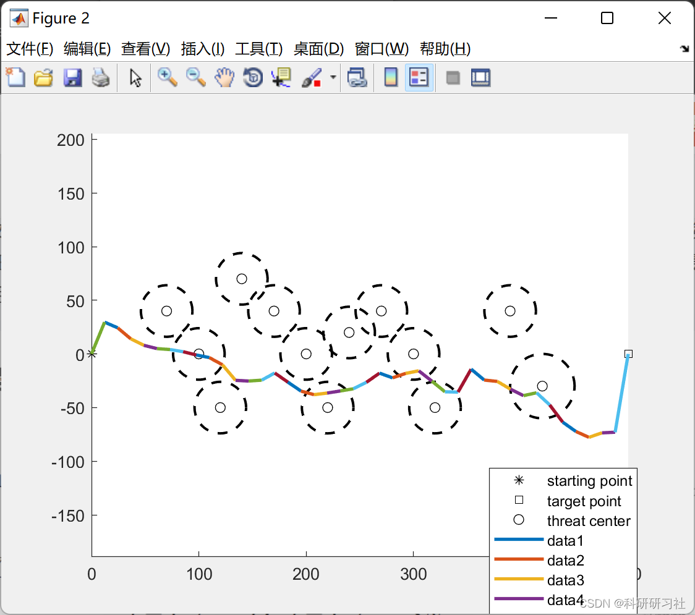
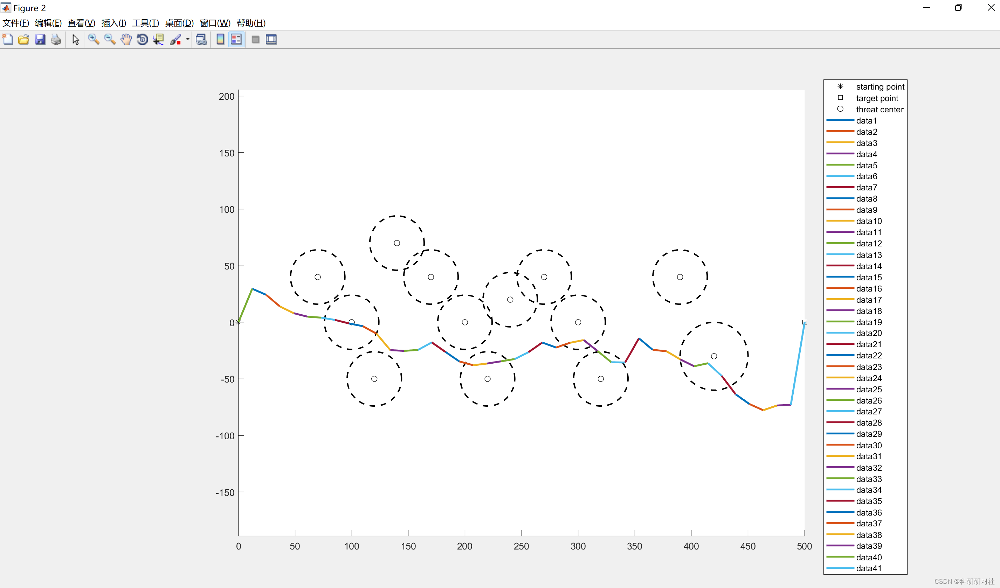
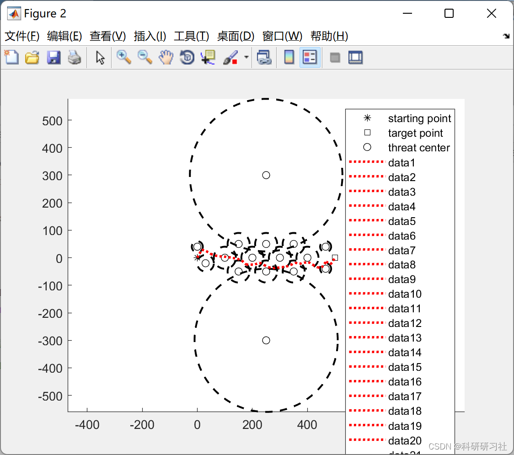
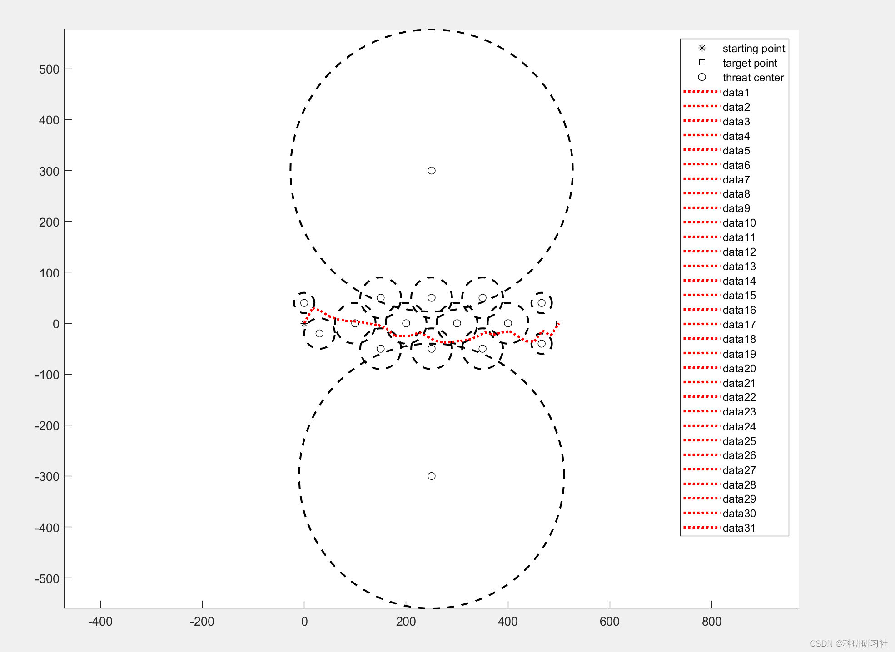
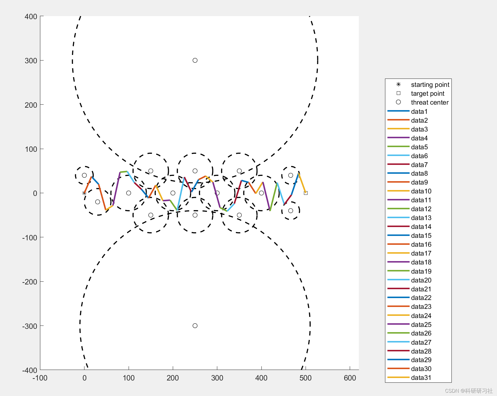
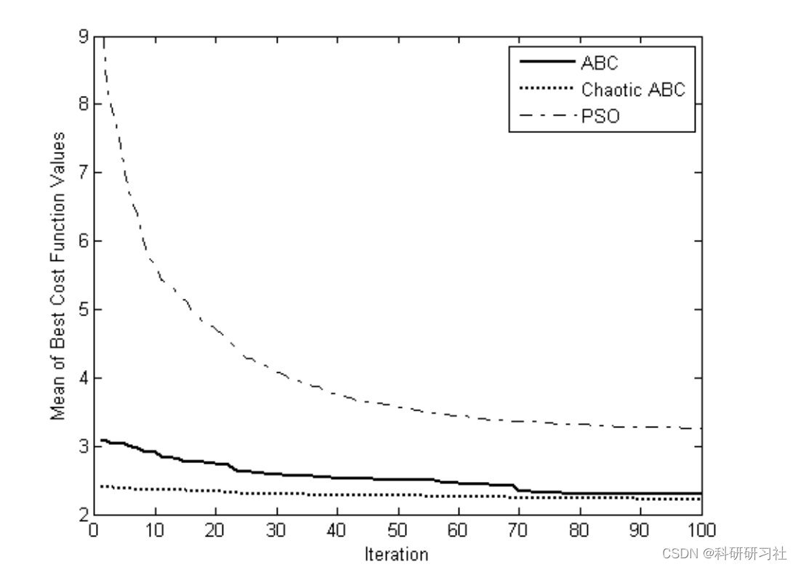
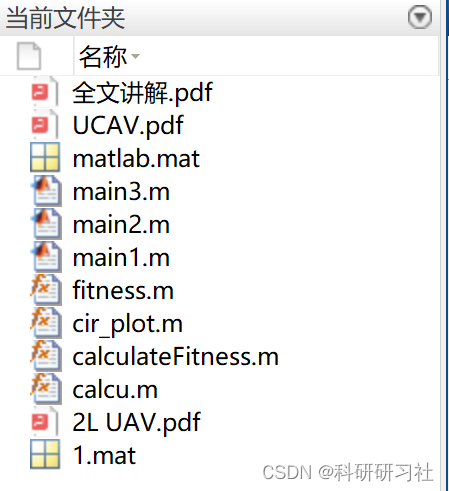

# New Probability Density Model for Unmanned Aerial Vehicle Path Planning Based on Artificial Bee Colony Algorithm (Matlab Code Implementation)

In recent years, Unmanned Combat Air Vehicles (UCAV) have attracted significant attention from many military organizations worldwide due to their capabilities in hazardous or complex environments [1]-[3]. Path planning systems are an integral part of the autonomous control module for UCAVs, providing the best path from the starting point to the desired destination. During flight, it is essential to avoid human threats and some natural constraints. For UCAV path planning tasks, the optimal solution corresponds to minimizing travel distance, average altitude, fuel consumption, radar or artillery exposure, etc. With the development of defense and defensive weapons, the complexity of modeling these human threats has significantly increased. To address the increasing complexity, researchers have gradually shifted their interests away from deterministic algorithms. In order to avoid the inefficient process of exhaustive search, intelligent algorithms such as Genetic Algorithm (GA), Differential Evolution Algorithm (DE), Particle Swarm Optimization Algorithm (PSO), and recently proposed Artificial Bee Colony Algorithm (ABC) [5]-[8] have been developed and studied in recent years.
The path planning for unmanned combat aerial vehicles (UCAV) aims to seek the optimal flight route that considers the threats and constraints along the way. This paper proposes a new probability density model, transforming the initial path planning task into a numerical problem. Compared with traditional circular processing models, this model has higher accuracy. The well-known Artificial Bee Colony (ABC) algorithm is employed to solve this corresponding optimization problem, and the convergence speed and efficiency of the proposed algorithm are compared with other intelligent algorithms in various combat domains. Experimental results have verified the superiority of ABC for the path planning problem of UCAVs with statistical significance. In this paper, a new probability density model is introduced, distinguishing different positions by their distance from the threat center. It also provides clear insights into the capabilities of ABC for the UCAV path planning problem. Simulation results have validated that the paths obtained by ABC are superior to those obtained by Particle Swarm Optimization (PSO), with statistical significance. Notably, this work initially focuses on two-dimensional path planning. The rest of this paper is arranged as follows: Section 2 introduces the principle of the proposed environmental model. The program for ABC is detailed in Section 3. Several carefully designed comparable simulation results are introduced and discussed in Section 4. Finally, the conclusion is drawn.
Intelligent optimization algorithms—Bee Optimization Algorithm (Matlab complete code implementation)
Solving economic dispatch of power systems based on the Bee Optimization Algorithm (Matlab code implementation)
Section 2: Mathematical Model Edit
The detailed mathematical model is described in Section 4.
Section 3: Running Results Edit
The running results are described in Section 4.
Section 4: Matlab Code and Full Text Explanation Edit
This section only showcases part of the code, all codes and detailed articles can be accessed by clicking here.
for r=1:runtime\nfor i = 1:FoodNumber\n    ObjVal(i) = calcu(Foods(i,:));\nend\nFitness = calculateFitness(ObjVal);\ntrial=zeros(1,FoodNumber);\nBestInd=find(ObjVal==min(ObjVal));\nBestInd=BestInd(end);\nGlobalMin = ObjVal(BestInd);\nGlobalParams=Foods(BestInd,:);\niter=1;\n\n\n\nwhile ((iter <= maxCycle)),\n    for i=1:(FoodNumber)\n        Param2Change=fix(rand*D)+1;\n        neighbour=fix(rand*(FoodNumber))+1;     \n            while(neighbour==i)\n                neighbour=fix(rand*(FoodNumber))+1;\n            end;  \n       sol=Foods(i,:);\n       sol(Param2Change)=Foods(i,Param2Change)+(Foods(i,Param2Change)-Foods(neighbour,Param2Change))*(rand-0.5)*2;\n        %\n        ind=find(sol<lb);\n        libai = rand(1,D).*(ub-lb)+lb;\n        sol(ind)=libai(ind);\n        ind=find(sol>ub);\n        libai = rand(1,D).*(ub-lb)+lb;\n        sol(ind)=libai(ind);\n        %\n        ObjValSol = calcu(sol);\n        FitnessSol=calculateFitness(ObjValSol);\n       if (FitnessSol>Fitness(i)) \n            Foods(i,:)=sol;\n            Fitness(i)=FitnessSol;\n            ObjVal(i)=ObjValSol;\n            trial(i)=0;\n        else\n            trial(i)=trial(i)+1;\n       end;\n     end;\nprob=(0.9.*Fitness./max(Fitness))+0.1;\ni=1;\nt=0;\nwhile(t<FoodNumber)\n    if(rand<prob(i))\n        t=t+1;\n        Param2Change=fix(rand*D)+1;\n        neighbour=fix(rand*(FoodNumber))+1;     \n            while(neighbour==i)\n                neighbour=fix(rand*(FoodNumber))+1;\n            end;\n        \n       sol=Foods(i,:);\n       sol(Param2Change)=Foods(i,Param2Change)+(Foods(i,Param2Change)-Foods(neighbour,Param2Change))*(rand-0.5)*2;\n        %\n        ind=find(sol<lb);\n        libai = rand(1,D).*(ub-lb)+lb;\n        sol(ind)=libai(ind);\n        ind=find(sol>ub);\n        libai = rand(1,D).*(ub-lb)+lb;\n        sol(ind)=libai(ind);\n        %\n        ObjValSol = calcu(sol);\n        FitnessSol=calculateFitness(ObjValSol);\n       if (FitnessSol>Fitness(i)) \n            Foods(i,:)=sol;\n            Fitness(i)=FitnessSol;\n            ObjVal(i)=ObjValSol;\n            trial(i)=0;\n        else\n            trial(i)=trial(i)+1; %/*if the solution i can not be improved, increase its trial counter*/\n       end;\n    end;\n    \n    i=i+1;\n    if (i==(FoodNumber)+1) \n        i=1;\n    end;   \nend; \n         ind=find(ObjVal==min(ObjVal));\n         ind=ind(end);\n         if (ObjVal(ind)<GlobalMin)\n         GlobalMin=ObjVal(ind);\n         GlobalParams=Foods(ind,:);\n         end;\n\n         \n         \n\nind=find(trial==max(trial));\nind=ind(end);\nif (trial(ind)>limit)\n    trial(ind)=0;\n    sol=(ub-lb).*rand(1,D)+lb;\n    ObjValSol = calcu(sol);\n    FitnessSol=calculateFitness(ObjValSol);\n    Foods(ind,:)=sol;\n    Fitness(ind)=FitnessSol;\n    ObjVal(ind)=ObjValSol;\nend;\nfprintf('iteration = %d ObjVal=%g\n',iter,GlobalMin);\naaaaa(iter) = GlobalMin;\niter=iter+1;\nend % End of ABC\n%storeer(r,:) = aaaaa;\nend\n\n\n% \n% figure (1)\n% a = mean(storeer);\n% plot(a)\n\nfigure (2)\nhold on\nplot(0,0,'k*')\nplot(500,0,'ks')\n\nfor i = 1:baili\nhold on\nplot(radar1(i),radar2(i),'ko');\ncir_plot([radar1(i),radar2(i)],R(i));\nend\nlegend('starting point','target point','threat center')\n\naxis equal\naxis([-100,620,-400,400])\nfor i = 1:(D-1)\n    plot([500/(D+1)*i,500/(D+1)*(i+1)],[GlobalParams(i),GlobalParams(i+1)],'LineWidth',2);\n    hold on\nend\nplot([0,500/(D+1)*(1)],[0,GlobalParams(1)],'LineWidth',2);\nplot([500/(D+1)*D,500],[GlobalParams(D),0],'LineWidth',2);\n  
5 Conclusions This paper aims to verify the practical capability of ABC in addressing the path planning problem for Unmanned Combat Air Vehicles (UCAV) through comparative analysis with other group intelligence algorithms. It is noteworthy that this study focuses on a few cases within 2D surfaces, and future efforts are still needed to validate ABC's capabilities in 3D spaces. Additionally, the selection of weight factors in the cost function remains a prominent issue in our model. By implementing on multi-core CPUs, it is possible to obtain feasible real-time paths for UCAV using ABC. Overall, the experimental results of the current work confirm statistically significant advantages over other intelligent algorithms in terms of convergence speed, efficiency, and robustness.
6 References [1] Bian Qiang, Sun Qi, Tong Yude. A Novel Improved A* Algorithm for UAV Three-Dimensional Path Planning [J]. Journal of Wuhan University of Technology, 2022, 44(07): 80-88.  
[2] Bai L, Gong L, Zhao C. Unmanned Combat Air Vehicle Path Planning Using a Novel Probability Density Model Based on Artificial Bee Colony Algorithm [C]// Intelligent Control and Information Processing (ICICIP), 2013 Fourth International Conference on. IEEE, 2013.

## Images

<!-- PAYMENT_BLOCK -->

## Get this dataset

- Payment link (Stripe): [Buy now](https://buy.stripe.com/3cs8yP7sY87d0vu9AB)
- Payment QR code: 

<!-- /PAYMENT_BLOCK -->
